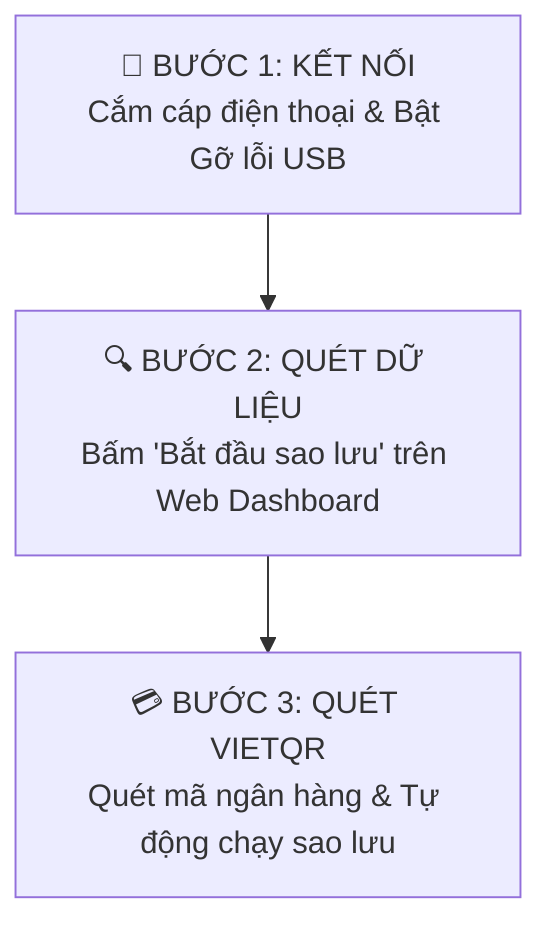

<div align="center">

# ⚡ NEXUS-ZALO 

### Giải Pháp Quản Lý, Sao Lưu & Chuyển Đổi Dữ Liệu Zalo Chuyên Nghiệp Đa Nền Tảng

[](https://github.com/tiendung102k3/Nexus-Zalo-Private)
[](https://github.com/tiendung102k3/Nexus-Zalo-Private)
[](https://nodejs.org)
[](https://vietqr.net)
[](https://github.com/tiendung102k3/Nexus-Zalo-Private)

<br/>

<p align="center">
  <b>Bảo vệ 100% tin nhắn, tài liệu, hình ảnh và video Zalo với chất lượng gốc.</b><br/>
  Chuyển máy mới 1-Click • Không cần Root máy • Không giới hạn dung lượng lưu trữ • Thanh toán VietQR tức thì
</p>

[Tính Năng](#-tính-năng-đột-phá) • [Bảng So Sánh](#-bảng-so-sánh-tính-năng) • [Cài Đặt & Thư Viện](#-hướng-dẫn-cài-đặt-chi-tiết) • [Quy Trình Sử Dụng](#-quy-trình-sử-dụng-3-bước) • [Bảo Mật](#-cam-kết-bảo-mật--quyền-riêng-tư) • [FAQ](#-câu-hỏi-thường-gặp)

---

</div>

## 🌟 Giới thiệu tổng quan

Bạn đang đổi sang điện thoại mới? Bạn kinh doanh online với hàng nghìn hóa đơn, tài liệu, hình ảnh sản phẩm quan trọng nhưng tính năng sao lưu mặc định của Zalo thường xuyên:
- ❌ **Mất ảnh cũ** hoặc bị giảm chất lượng trầm trọng.
- ❌ **Báo hết dung lượng Cloud** và yêu cầu nâng cấp gói đắt đỏ.
- ❌ **Treo tiến trình** khi dữ liệu lớn (> 5GB).

**Nexus-Zalo** là phần mềm chuyên dụng được thiết kế để giải quyết dứt điểm các vấn đề trên. Ứng dụng cung cấp giao diện Web trực quan, vận hành độc lập, cho phép bạn trích xuất trọn vẹn toàn bộ dữ liệu Zalo sang máy tính hoặc bộ nhớ ngoài và khôi phục vào điện thoại mới bất kỳ lúc nào.

---

## 💎 Tính năng đột phá

```
┌────────────────────────────────────────────────────────────────────────┐
│                        TÍNH NĂNG NỔI BẬT                               │
├────────────────────────────┬───────────────────────────────────────────┤
│ 🚀 Sao lưu 1-Click         │ Tự động nhận diện thiết bị & tính phí     │
│ 📁 Trình duyệt Explorer    │ Xem trực tiếp ảnh, video đã nén trên Web  │
│ 🔄 Chuyển đổi liên máy     │ Khôi phục mượt mà giữa Samsung, Xiaomi,...│
│ 🛡️ Chống mất dữ liệu       │ Tự động tạo bản Rollback an toàn trước    │
│ ⚡ Thanh toán VietQR       │ Tự động kích hoạt dịch vụ sau 3 giây      │
│ 📱 Hỗ trợ Termux           │ Chạy độc lập ngay trên điện thoại Android │
└────────────────────────────┴───────────────────────────────────────────┘
```

### 1. Giữ nguyên 100% chất lượng gốc
Mọi hình ảnh độ phân giải cao, video dung lượng lớn, tệp tin PDF, Excel, tài liệu hợp đồng và tin nhắn thoại đều được đóng gói nguyên vẹn.

### 2. Không giới hạn dung lượng lưu trữ
Hỗ trợ sao lưu các tài khoản Zalo kinh doanh thâm niên với dung lượng từ vài GB cho đến **hàng trăm GB** mà không bị giới hạn lưu trữ.

### 3. Tích hợp thanh toán VietQR thông minh
Hệ thống tự động đo dung lượng dữ liệu và tạo mã QR thanh toán động. Bạn chỉ cần mở app ngân hàng quét mã, hệ thống tự động nhận diện và kích hoạt sau **3 giây**.

### 4. Quản trị đa thiết bị trực quan
Giao diện Dark Theme hiện đại, hiển thị trực quan thông tin Model máy (ví dụ: *Samsung Galaxy S23 Ultra*, *Xiaomi 13 Pro*), tình trạng kết nối, dung lượng pin và bộ nhớ khả dụng theo thời gian thực.

---

## 📊 Bảng so sánh tính năng

| Tiêu chuẩn kỹ thuật | Sao lưu mặc định Zalo | Công cụ bên thứ 3 | Nexus-Zalo v2.2.0 |
|:---|:---:|:---:|:---:|
| **Ảnh & Video chất lượng gốc** | Bị nén / Hết hạn | Hạn chế | ⭐ **Giữ nguyên 100%** |
| **Dung lượng sao lưu tối đa** | Bị giới hạn | < 10 GB | ⭐ **Không giới hạn (> 500 GB)** |
| **Yêu cầu can thiệp Root** | Không | Cần Root | ⭐ **Không cần Root máy** |
| **Xem trước tệp (Preview)** | Không | Không | ⭐ **Trình duyệt Explorer tích hợp** |
| **Quyền riêng tư dữ liệu** | Đẩy lên máy chủ lạ | Lưu đám mây | ⭐ **Lưu 100% cục bộ trên máy bạn** |
| **Tự động Rollback dự phòng** | Không có | Rất hiếm | ⭐ **Tự động tạo bản lưu tạm** |

---

## ⚡ Hướng dẫn cài đặt chi tiết

Nexus-Zalo yêu cầu 2 thành phần nền tảng: **Node.js** (chạy web dashboard) và **ADB** (cầu nối kết nối điện thoại Android). Hãy chọn hệ điều hành bạn đang sử dụng dưới đây:

---

### 🪟 1. Dành cho Windows

#### Bước 1: Cài đặt Node.js
1. Tải bản cài đặt **Node.js LTS (phiên bản 20 trở lên)** tại: 👉 **[https://nodejs.org](https://nodejs.org)**.
2. Chạy tệp `.msi`, nhấn **Next** theo mặc định và chọn **Install**.

#### Bước 2: Cài đặt ADB (Android Debug Bridge)
Bạn có thể chọn **1 trong 2 cách** sau:

- **Cách 1 (Tự động qua Windows Package Manager - Khuyên dùng):**
  Mở PowerShell (Run as Administrator) và chạy lệnh:
  ```powershell
  winget install Google.PlatformTools
  ```

- **Cách 2 (Cài đặt thủ công):**
  1. Tải bộ công cụ chính thức từ Google: 👉 **[SDK Platform-Tools for Windows](https://developer.android.com/tools/releases/platform-tools)**.
  2. Giải nén vào một thư mục cố định (ví dụ: `C:\platform-tools`).
  3. Thêm thư mục vào biến môi trường:
     - Bấm phím `Windows`, gõ **env** và chọn **Edit the system environment variables**.
     - Nhấp nút **Environment Variables...** $\rightarrow$ Tại ô *System variables*, chọn dòng **Path** $\rightarrow$ bấm **Edit...**.
     - Bấm **New** $\rightarrow$ Dán đường dẫn `C:\platform-tools` $\rightarrow$ Nhấn **OK** lưu lại.

> [!TIP]
> **Cài đặt Driver kết nối (Nếu máy tính chưa nhận điện thoại):**  
> Hầu hết máy tính tự nhận khi cắm cáp. Nếu chưa nhận, bạn chỉ cần cài bộ driver tương ứng:
> - Samsung: [Samsung Smart Switch](https://www.samsung.com/us/support/owners/app/smart-switch)
> - Xiaomi / Oppo / Các dòng khác: [Google Universal ADB Driver](https://adb.clockworkmod.com/)

#### Bước 3: Tải mã nguồn & Cài đặt Nexus-Zalo

Mở CMD hoặc PowerShell và chạy:

\```bash
git clone https://github.com/tiendung102k3/Nexus-Zalo.git
cd Nexus-Zalo
\```

Sau đó nhấp đúp vào file **`install.bat`** để hoàn tất cài đặt.

#### Bước 4: Khởi động Nexus-Zalo

Mở CMD hoặc PowerShell tại thư mục **Nexus-Zalo** và chạy:

\```bash
npm start
\```

Trình duyệt truy cập trang quản trị tại: **`http://127.0.0.1:5178`**.

---

### 🤖 2. Dành cho Android (Termux)

Chạy ứng dụng trực tiếp ngay trên điện thoại mà không cần máy tính:

#### Bước 1: Cài đặt Termux
- Tải ứng dụng **Termux** từ [F-Droid](https://f-droid.org/en/packages/com.termux/) (Khuyến nghị, không tải trên Google Play vì phiên bản đã cũ).

#### Bước 2: Tải mã nguồn & Cài đặt

Mở Termux và chạy lần lượt:

\```bash
pkg update -y && pkg upgrade -y
pkg install -y git
git clone https://github.com/tiendung102k3/Nexus-Zalo.git
cd Nexus-Zalo
chmod +x install.sh
./install.sh
\```

#### Bước 3: Khởi động ứng dụng

Sau khi cài đặt hoàn tất, chạy lệnh:

\```bash
npm start
\```

Mở trình duyệt trên điện thoại và truy cập:

**`http://127.0.0.1:5178`**

---

### 🍏 3. Dành cho macOS

#### Bước 1: Cài đặt Node.js & ADB qua Homebrew (Nhanh nhất)
Mở ứng dụng **Terminal** và chạy các lệnh:
```bash
# Cài đặt Homebrew (nếu máy chưa có)
/bin/bash -c "$(curl -fsSL https://raw.githubusercontent.com/Homebrew/install/HEAD/install.sh)"

# Cài đặt Node.js và Android Platform Tools
brew install node
brew install --cask android-platform-tools
```

#### Bước 2: Tải mã nguồn & Cài đặt Nexus-Zalo

\```bash
git clone https://github.com/tiendung102k3/Nexus-Zalo.git
cd Nexus-Zalo
chmod +x install.sh
./install.sh
\```

#### Bước 3: Khởi động Nexus-Zalo

\```bash
npm start
\```

Sau khi khởi động, mở trình duyệt và truy cập:

**`http://127.0.0.1:5178`**
---

### 🐧 4. Dành cho Linux (Ubuntu, Debian, Fedora, Arch)

Mở Terminal và cài đặt nhanh các gói cần thiết:

- **Ubuntu / Debian:**
  ```bash
  sudo apt update
  sudo apt install -y nodejs npm adb zip unzip tar
  ```
- **Fedora / RHEL:**
  ```bash
  sudo dnf install -y nodejs npm android-tools zip unzip tar
  ```
- **Arch Linux:**
  ```bash
  sudo pacman -S nodejs npm android-tools zip unzip tar
  ```

Tải mã nguồn và cài đặt Nexus-Zalo:

\```bash
git clone https://github.com/tiendung102k3/Nexus-Zalo.git
cd Nexus-Zalo
chmod +x install.sh
./install.sh
\```

Khởi chạy ứng dụng:

\```bash
npm start
\```

Sau khi khởi chạy, truy cập:

**`http://127.0.0.1:5178`**

---

## 🎯 Quy trình sử dụng 3 bước



### Bước 1: Bật Gỡ lỗi USB trên điện thoại
1. Dùng cáp USB nối điện thoại Android với máy tính.
2. Trên điện thoại, vào **Cài đặt** $\rightarrow$ **Thông tin điện thoại** $\rightarrow$ Nhấp 7 lần vào mục **Số bản dựng (Build Number)** đến khi có thông báo *"Bạn đã là nhà phát triển"*.
3. Quay lại Cài đặt $\rightarrow$ Vào **Tùy chọn nhà phát triển (Developer Options)** $\rightarrow$ Bật mục **Gỡ lỗi USB (USB Debugging)**.
4. Màn hình điện thoại hiện bảng hỏi: *"Cho phép gỡ lỗi USB từ máy tính này?"* $\rightarrow$ Tích chọn **Luôn cho phép** và bấm **OK**.

### Bước 2: Khởi tạo tiến trình
1. Truy cập **`http://127.0.0.1:5178`** trên trình duyệt.
2. Tại trang **Sao lưu (Backups)**, chọn điện thoại nguồn cần sao lưu.
3. Bấm **💾 Bắt đầu sao lưu ngay**. Hệ thống sẽ tự động đo dung lượng và hiển thị bảng thanh toán VietQR.

### Bước 3: Quét mã & Hoàn tất
1. Sử dụng ứng dụng ngân hàng bất kỳ (MBBank, Vietcombank, Techcombank, VPBank, MoMo,...) quét mã **VietQR** hiển thị trên màn hình.
2. Sau khi thanh toán, hệ thống tự động đổi trạng thái sang `✅ Thanh toán thành công!` và kích hoạt tiến trình nén dữ liệu.
3. Toàn bộ dữ liệu được đóng gói an toàn và lưu trữ tại máy của bạn.

---

## 🔒 Cam kết bảo mật & Quyền riêng tư

> [!IMPORTANT]
> **AN TOÀN TUYỆT ĐỐI CHO DỮ LIỆU CỦA BẠN**
> - **100% Lưu trữ cục bộ:** Dữ liệu được truyền trực tiếp từ điện thoại sang máy tính của bạn qua đường cáp USB vật lý. Phần mềm tuyệt đối **không gửi bất kỳ file hình ảnh, tin nhắn hay dữ liệu nào của bạn lên mạng Internet**.
> - **Không can thiệp phần cứng:** Hoạt động qua giao thức chuẩn của hệ điều hành Android, không yêu cầu can thiệp Root máy, không làm mất bảo hành điện thoại hay gây nguy cơ bảo mật cho tài khoản ngân hàng trên máy.
> - **Cơ chế Rollback dự phòng:** Trước khi khôi phục dữ liệu vào máy mới, hệ thống tự động lưu trữ tạm dữ liệu cũ. Nếu xảy ra sự cố tuột cáp mạng hay mất nguồn, dữ liệu cũ vẫn được bảo toàn nguyên vẹn.

---

## ❓ Câu hỏi thường gặp (FAQ)

<details>
<summary><b>1. Làm sao kiểm tra xem máy tính đã nhận diện được điện thoại chưa?</b></summary>
Mở CMD / Terminal và gõ lệnh: <code>adb devices</code>. Nếu thấy danh sách hiện ra mã thiết bị và chữ <code>device</code> (ví dụ: <code>R58M123456 device</code>) nghĩa là kết nối đã hoàn toàn thành công!
</details>

<details>
<summary><b>2. Dữ liệu sao lưu được lưu trữ ở đâu?</b></summary>
Mặc định bản sao lưu được lưu dưới dạng file nén ZIP an toàn tại thư mục cấu hình (ví dụ: <code>Download/Nexus-Backups</code> hoặc thư mục riêng của bạn). Bạn có thể đổi thư mục bất cứ lúc nào trong mục <b>Cài đặt</b> trên Dashboard.
</details>

<details>
<summary><b>3. Tôi có thể chuyển dữ liệu giữa các hãng điện thoại khác nhau không?</b></summary>
Hoàn toàn được! Nexus-Zalo hỗ trợ chuyển dữ liệu mượt mà giữa tất cả các hãng điện thoại chạy Android: Samsung, Xiaomi, Oppo, Vivo, Realme, OnePlus, Sony, Google Pixel,...
</details>

<details>
<summary><b>4. Làm thế nào để xem lại hình ảnh trong file sao lưu mà không cần đẩy vào điện thoại?</b></summary>
Rất đơn giản! Bạn chỉ cần vào mục <b>Khám phá (Explorer)</b> trên Web Dashboard, hệ thống cho phép bạn duyệt xem trực tiếp cấu trúc cây thư mục và mở xem hình ảnh, video trực tiếp ngay trên trình duyệt máy tính.
</details>

<details>
<summary><b>5. Quét mã VietQR xong mất bao lâu để hệ thống nhận diện?</b></summary>
Hệ thống sử dụng cổng đối soát số dư tức thì. Ngay sau khi bạn bấm xác nhận chuyển tiền trên ứng dụng ngân hàng, màn hình sẽ tự động nhận diện thanh toán thành công trong vòng <b>3 đến 5 giây</b>.
</details>

---

## 📞 Hỗ trợ kỹ thuật & Bản quyền

- **Sản phẩm:** Nexus-Zalo Migration Suite
- **Phiên bản hiện tại:** `v2.2.0`
- **Tác giả:** tiendung102k3
- **Chính sách hỗ trợ:** Hỗ trợ kỹ thuật trọn đời cho các phiên bản chính thức.
